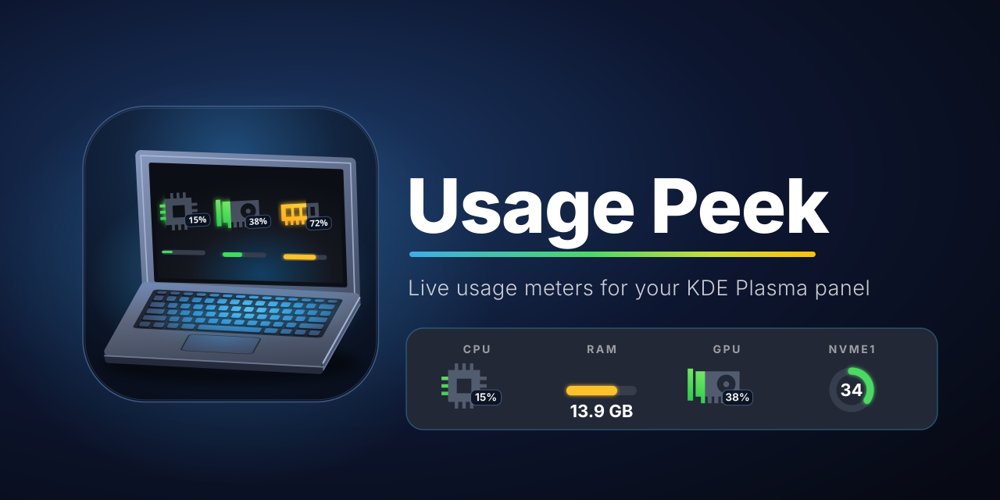

<p align="center">
  
</p>

# Usage Peek

A KDE Plasma 6 widget that shows CPU, memory, swap and disk usage in your panel (or on the desktop)
as a circle gauge, top bar, progress line, hardware icon or plain text. Sister project of
[Thermal Peek](../ThermalPeek) with the same look and settings.

## Features
- **5 display modes:** circle gauge, top bar, progress line, hardware icon, text only
- **Usage sensors from KSysGuard:** total and per-core CPU usage, physical memory and swap, every
  disk and partition, as a percentage (`12%`) or as an amount (`15.9 GB`)
- **Hardware icons:** CPU, RAM, swap, HDD, SSD, NVMe, disk, bolt, unknown and point glyphs, picked
  automatically per sensor (or manually). Set the icon colour, the fill colour (fixed or by level)
  and whether the icon fills bottom-to-top or left-to-right like a progress bar
- **Tags** (CPU, RAM, SWAP, ROOT…) with automatic suggestions, editable per sensor, shown above,
  below, left or right
- **Reorderable** sensors on a dedicated *Order* page
- **Level colours:** 4 thresholds split usage into 5 levels, each with its own colour
- **Adjustable spacing** between sensors and between tag and gauge
- Optional value text, custom text colour, font size, gauge size and update rate
- Sensors that disappear (an unplugged or unmounted disk) are hidden but stay saved
- In a panel the gauge scales to the panel thickness

## Requirements
- KDE Plasma 6 (developed and tested on 6.7.5)
- KSysGuard sensors (`ksystemstats`, `libksysguard`)

## Install
From the project directory:

```bash
kpackagetool6 -t Plasma/Applet -i .      # first install
kpackagetool6 -t Plasma/Applet -u .      # update
kpackagetool6 -t Plasma/Applet -r org.kde.usagepeek   # remove
```

Install the widget icon once (shown in *Add Widgets*):

```bash
install -Dm644 docs/logo.svg \
  ~/.local/share/icons/hicolor/scalable/apps/org.kde.usagepeek.svg
```

Reload the shell:

```bash
systemctl --user restart plasma-plasmashell.service
# or: kquitapp6 plasmashell && kstart plasmashell
```

## Usage
1. Right-click the panel → **Add Widgets…** → search **Usage Peek** → drag it into the panel.
2. Right-click the widget → **Configure Usage Peek…**
3. Pages: **Sensors** (tick sensors, edit tags and icons), **Order** (move sensors up or down),
   **Appearance** (display mode, colours, spacing, thresholds).

Changes made on the *Sensors* page need **Apply** before they appear on the *Order* page.

### Picking sensors
| Want | Choose |
| --- | --- |
| Total CPU load | `cpu/all/usage` |
| Memory as percent | `memory/physical/usedPercent` |
| Memory as amount | `memory/physical/used` (the fill uses `memory/physical/total`) |
| Swap | `memory/swap/usedPercent` or `used` |
| A disk or partition | `disk/<id>/usedPercent` or `used` |

Amounts are shown in binary units (1 GB = 1024 MB). Percent and amount sensors both fill the gauge
by how full the resource is.

## Development
Test without installing (needs `plasma-sdk`):

```bash
plasmoidviewer -a . -l topedge     # or: -f horizontal
```

```
metadata.json                  plugin id: org.kde.usagepeek
contents/config/main.xml       settings schema
contents/config/config.qml     config page list (Sensors, Order, Appearance)
contents/ui/main.qml           layout of all sensors, panel handling
contents/ui/SensorItem.qml     one sensor: value, level logic, tag and chosen gauge
contents/ui/ValueLabel.qml     value text
contents/ui/Tags.js            tags, icon guessing, byte formatting
contents/ui/gauges/            CircleGauge, BarGauge
contents/ui/config/            Sensors, Order, Appearance and Presets pages
contents/icons/glyphs/         hardware glyphs for the icon mode (single-colour masks)
docs/logo.svg                  project logo, also the widget icon
docs/banner.svg                README banner (banner.png is generated, git-ignored)
```

## Roadmap
- Disk read/write rates and network throughput
- Per-sensor display mode and name

## License
MIT (see `metadata.json`). Add a `LICENSE` file before publishing.
